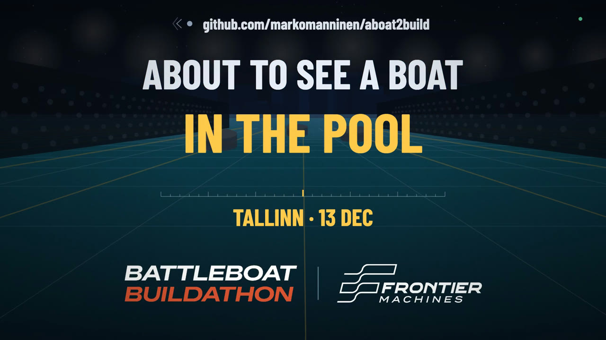

# aboat2build

One person and three AI agent swarms are building a fully autonomous, 3D-printed boat for Battleboat Buildathon #01 in Tallinn. The build started from an empty folder on 19 November 2026, and the boat has to drive by itself in a pool on 13 December 2026.

The picture opens the 30-second kickoff video on YouTube, which tells the first day of the build. The same video is in this repository as the file [media/kickoff30.mp4](media/kickoff30.mp4).

## The event

Battleboat Buildathon #01 is organised by [Frontier Machines](https://frontiermachines.com/) at Glazeworks in Tallinn, and the event's own site is [aggressivemachines.com](https://aggressivemachines.com/). Each team builds a small boat that runs with no remote control. On the competition day a boat first drives an obstacle course against the clock and then meets other boats one against one.

| Day | What happens |
| --- | --- |
| Fri 27 Nov 2026 | Kickoff, where the rules are published |
| Wed 2 Dec and Wed 9 Dec 2026 | Lab nights at the venue |
| Fri 11 Dec 2026 | Test day |
| Sun 13 Dec 2026 | Competition |

## Who builds it

Marko Manninen takes part in the event with his own project, and he is its builder. He makes the decisions and does the work that needs hands, which is buying, printing, gluing, wiring and testing in water. Three agent swarms do the desk work. A swarm here means one AI coding tool that runs several agents at the same time.

| Swarm | What it does in this build |
| --- | --- |
| Claude Code | Runs the project, writes the build plan and the simulator, and hands work to the other two |
| Codex | Reviews the code and the plans as an outside reader and writes boat software against the simulator |
| Antigravity | Reads shop pages with a browser and checks the facts the plan rests on |

The page [How the work runs](docs/method.md) describes the method, and the [build log](docs/log.md) follows the build day by day.

## The first day in numbers

The kickoff video counts what existed on 20 November 2026, one day after the start.

| Count | What it measures |
| --- | --- |
| 330 matches | Matches played and recorded in a simulator of the pool, written before anything was bought |
| 10 drafts | Versions of the build plan, each rewritten from the findings of a review |
| 119 findings | Faults that one reader found in one draft when it saw only the text |
| 1,133 tests | Automated tests in the repository |
| 105 to 143 hours | Working hours the plan needs before the competition |
| 89 hours | Working hours the builder has before the competition |

The last two rows are the reason the video says cut, re-plan, repeat. The plan needs more hours than the builder has, so every new draft has to drop or shorten work.

## What is published and when

This repository shows the method and the progress now. The hull, the sensors, the tactics and what the simulator has taught stay private until the competition, because another team could use them. After the competition on 13 December 2026 more of the project is published here, and the builder decides which parts.

## Licence

The texts and the video in this repository may be used, shared and adapted for non-commercial purposes such as study and education, when the user credits Marko Manninen and links to this repository. The licence is [Creative Commons Attribution-NonCommercial 4.0 International](https://creativecommons.org/licenses/by-nc/4.0/), and its full text is in the file [LICENSE](LICENSE). The names and logos of the event, its organiser and the AI tools belong to their owners and stay outside this licence.
